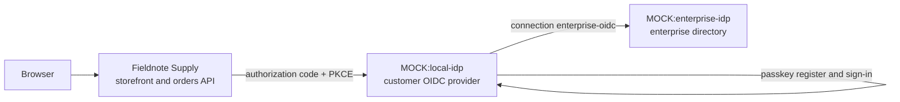
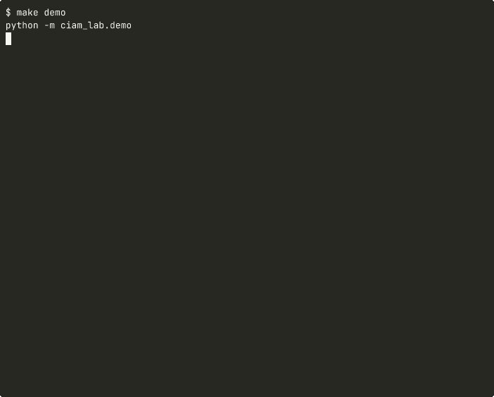

# ciam-lab

Personal lab project for customer identity and access management. Synthetic users only. This project is not affiliated with any employer.

Fieldnote Supply is a small storefront. Customers sign in with OpenID Connect (authorization code and PKCE), can register a passkey, or arrive through one enterprise federation connection. A protected orders API checks scopes on the access token.

The default mode runs entirely offline. Two mock providers are included. Discovery documents and page banners label them:

- `MOCK:local-idp` is the customer identity provider
- `MOCK:enterprise-idp` is the upstream enterprise directory

You can point the storefront at an Auth0 free-plan tenant instead. See [docs/auth0-setup.md](docs/auth0-setup.md). Never commit real credentials.

## Quickstart

Requires Python 3.11 or newer.

```bash
python -m pip install -e ".[dev]"
make demo
```

`make demo` signs in as a synthetic customer, prints ID token and access token checks, registers and uses a passkey through a soft authenticator, signs in through the enterprise connection, then calls the orders API with the ID token on purpose and shows the fix.

The script pauses so the steps can be read. Skip the pauses with:

```bash
DEMO_PACE_SECONDS=0 make demo
```

Leave the lab running and open http://127.0.0.1:8000:

```bash
python -m ciam_lab.serve
```

Synthetic passwords, used only by the mock providers:

| Who | Email | Password | Where to use it |
| --- | --- | --- | --- |
| Alice Nguyen | alice@example.com | correct-horse | Customer provider |
| Bob Patel | bob@example.com | river-stone | Customer provider |
| Sam Okonkwo | sam@enterprise.example | warehouse-key | Enterprise provider, via "Sign in with your organization" |

## Auth0 mode

```bash
export IDP_MODE=auth0
export AUTH0_DOMAIN=your-tenant.us.auth0.com
export AUTH0_CLIENT_ID=your-client-id
export AUTH0_CLIENT_SECRET=your-client-secret
export AUTH0_AUDIENCE=https://api.fieldnote.lab
python -m ciam_lab.serve
```

Start from [.env.example](.env.example). Do not commit a filled-in `.env`. The offline walkthrough (`make demo`) always uses the local mocks, even if those variables are set in the shell.

## Architecture



In Auth0 mode the storefront uses your tenant in place of `MOCK:local-idp`. Passkeys and the local enterprise broker stay on the mocks, so use local mode for those two tours. Detail is in [docs/architecture.md](docs/architecture.md).

## Feature tour

1. **OIDC authorization code and PKCE.** The storefront sends `state`, `nonce`, and an S256 `code_challenge`. The callback checks `state`, exchanges the code with the verifier, and validates the ID token (issuer, audience, expiry, JWKS signature, nonce) and the access token (issuer, audience, expiry, signature, `token_use`).
2. **Logout.** The storefront clears its session and calls the provider end-session endpoint.
3. **Passkeys.** `MOCK:local-idp` is the WebAuthn relying party. Tests and `make demo` drive a soft authenticator. The login page can also use a platform authenticator in a browser.
4. **Enterprise federation.** One connection, `enterprise-oidc`, brokers `MOCK:enterprise-idp`. The customer provider validates the upstream ID token, links the person by email, and issues its own tokens to the storefront. `amr` is `fed`.
5. **Consent and scopes.** The customer provider shows the requested scopes before it issues a code. `GET /api/orders` requires `orders:read`. `POST /api/orders` requires `orders:write`.
6. **Token troubleshooting.** Each common failure has a reproduction in the test suite. See [docs/troubleshooting.md](docs/troubleshooting.md).

## Tests and checks

```bash
make lint
make test
make demo
```

GitHub Actions runs lint, the tests, and `make demo`.

## Layout

| Path | Role |
| --- | --- |
| `src/ciam_lab/app.py` | Storefront and orders API |
| `src/ciam_lab/provider.py` | Both mock OIDC providers |
| `src/ciam_lab/tokens.py` | Minting and Authlib validation |
| `src/ciam_lab/soft_authenticator.py` | Virtual passkey used by tests and the demo |
| `src/ciam_lab/demo.py` | `make demo` |
| `docs/` | Architecture, Auth0 setup, troubleshooting |

## Demo



Optional containers: `docker compose up --build`, then open http://127.0.0.1:8000. The container still uses the local mocks.
