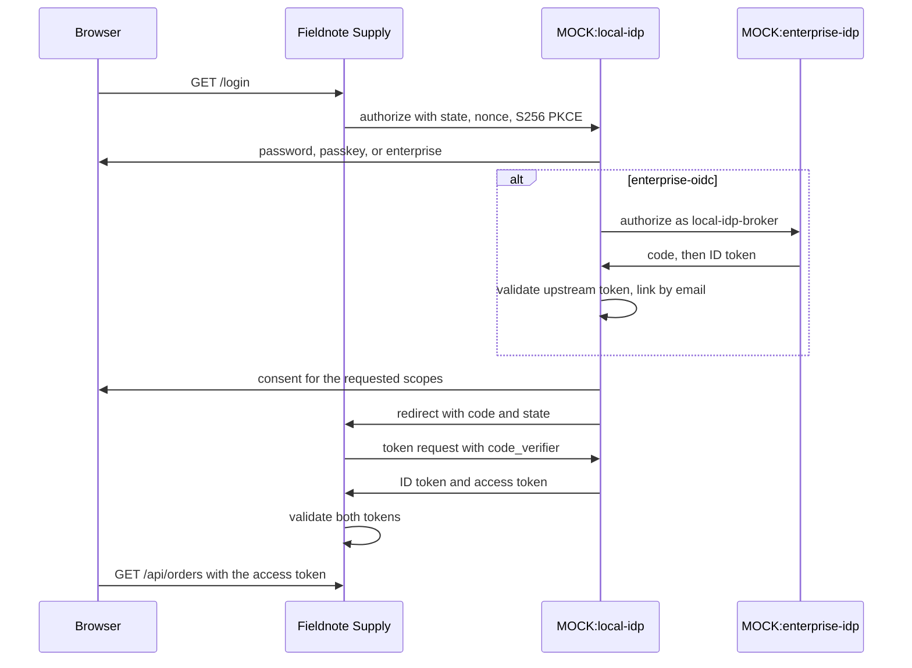

# Architecture

Personal lab project. Synthetic users only. Not affiliated with any employer.

The lab has three processes in local mode, all on one machine:

| Process | Default URL | Label |
| --- | --- | --- |
| Fieldnote Supply | http://127.0.0.1:8000 | storefront and resource server |
| Customer identity provider | http://127.0.0.1:9000 | `MOCK:local-idp` |
| Enterprise directory | http://127.0.0.1:9001 | `MOCK:enterprise-idp` |

Keys are generated in memory when a provider starts. Nothing secret is written to the repo. Restarting the lab mints new signing keys, and previously issued tokens stop verifying.

## What each token is for

The ID token audience is the client id `ciam-lab` (or the Auth0 client id). It tells the storefront who signed in. The storefront checks `nonce` against the value it stored before the redirect.

The access token audience is `https://api.fieldnote.lab` unless `API_AUDIENCE` or `AUTH0_AUDIENCE` overrides it. The orders API is the resource server. It checks the signature against the issuer JWKS, then issuer, audience, expiry, `token_use`, and the required scope.

Local tokens include a lab claim, `lab_idp`, set to `MOCK:local-idp` or `MOCK:enterprise-idp`. A real provider will not send that claim. The API does not require it.

`amr` records the method: `pwd`, `webauthn`, or `fed`.

## Passkeys

WebAuthn registration and authentication are hosted by `MOCK:local-idp`, which is the relying party. The rp id is the host (`127.0.0.1` by default) and the expected origin is the provider origin.

`src/ciam_lab/soft_authenticator.py` is a virtual authenticator. It creates a P-256 key, builds an attestation with format `none`, and signs assertions. `py_webauthn` verifies those ceremonies in the provider. The same endpoints serve a browser that calls `navigator.credentials`.

A passkey sign-in still finishes as an OIDC code flow, so the storefront receives normal tokens with `amr=webauthn`.

## Enterprise connection

There is one upstream connection, named `enterprise-oidc`.

1. The storefront starts login with `connection=enterprise`.
2. `MOCK:local-idp` is an OIDC client of `MOCK:enterprise-idp` (`client_id=local-idp-broker`), again with PKCE.
3. The customer provider validates the enterprise ID token: signature, issuer, audience `local-idp-broker`, expiry, and nonce.
4. It links the email to a customer record. Sam Okonkwo is pre-linked as `user_sam`. An unknown email would be created on the spot for the lab session.
5. The customer provider shows consent, then issues its own tokens. The ID token carries `federated_sub` and `federated_issuer`.

The storefront never trusts the enterprise provider directly.

## Consent

Requested scopes are `openid`, `profile`, `email`, `orders:read`, and `orders:write`. The customer provider shows each scope in plain language. Deny redirects back with `error=access_denied` and no code. Allow mints a code bound to the granted scopes.

`prompt=consent` (the storefront default) shows the screen on every login. A remembered grant is used only when the client omits that prompt.

## Auth0 swap

`IDP_MODE=auth0` changes the storefront's issuer, client id, client secret, and API audience. Discovery, the authorize URL, the token request, and JWKS validation stay on the same code path. Authlib still builds the PKCE authorize URL and exchanges the code.

Auth0 access tokens are JWTs when an audience is set. The lab rejects opaque tokens. Setup steps are in [auth0-setup.md](auth0-setup.md).

Passkey ceremonies and the in-process enterprise broker are part of the local mocks. They are not routed through Auth0. An optional `AUTH0_ENTERPRISE_CONNECTION` adds Auth0's `connection` parameter to the organization button.

## Clock skew

Validators allow `TOKEN_LEEWAY_SECONDS` (default 10) around `exp`, `iat`, and `nbf`. That window is intentionally small so an expired token and a skewed clock fail in tests instead of being silently accepted.
